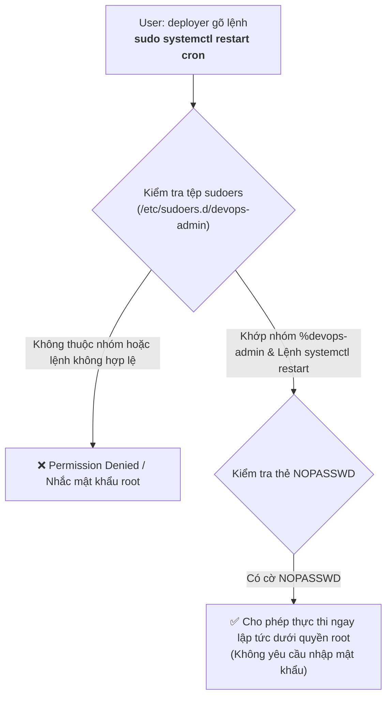
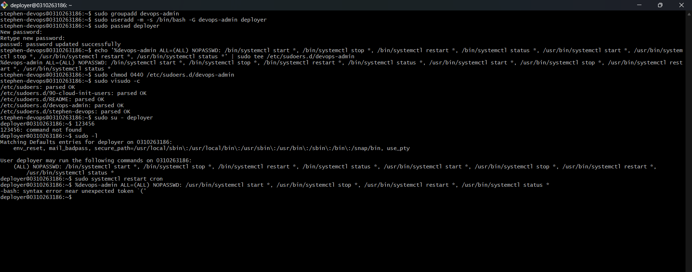

# BÀI TẬP 2: CẤU HÌNH PHÂN QUYỀN NHÓM VÀ SUDOERS BẰNG VISUDO

**Mã bài tập:** SESSION 06 - EXERCISE 2 (`homework/session_06/ex2/`)  
**Môn học:** IT215 - Cloud Infrastructure & DevOps Fundamentals  
**Học viên:** Trần Đức Anh (`TranDucAnh3103`)  
**Email:** `TranDucAnh3103@users.noreply.github.com`  
**Hệ điều hành / Môi trường:** Ubuntu Linux (Server ID: `0310263186`) / Bash Shell / Tài khoản kiểm tra: `deployer`  
**Đường dẫn thư mục bài tập:** `homework/session_06/ex2/`  

---

## 1. MỤC TIÊU BÀI TẬP

1. **Quản trị người dùng và nhóm người dùng trên Linux:** Biết cách tạo nhóm người dùng mới (`groupadd`) và tạo tài khoản chuyên trách (`useradd` / `adduser`) kèm việc gán nhóm phụ (`usermod` / cờ `-G`).
2. **Hiểu rõ kiến trúc và cơ chế kiểm soát đặc quyền sudo:** Nắm vững cấu trúc tệp tin cấu hình đặc quyền `/etc/sudoers` và thư mục mở rộng `/etc/sudoers.d/`.
3. **Phân quyền có kiểm soát (Principle of Least Privilege):** Cấp quyền hạn tối thiểu cho tài khoản tự động hóa (`deployer`) chỉ được phép quản lý dịch vụ hệ thống qua `systemctl` (start, stop, restart, status) mà không cấp toàn quyền `root`.
4. **Tối ưu hóa quy trình tự động hóa (Automation & CI/CD):** Cấu hình cờ `NOPASSWD` cho các lệnh được chỉ định giúp script triển khai tự động thực thi trơn tru mà không bị nghẽn do đòi hỏi mật khẩu tương tác.
5. **Đảm bảo an toàn cấu hình hệ thống:** Áp dụng phương thức kiểm tra cú pháp nghiêm ngặt bằng `visudo -c` và thiết lập quyền đọc tối thiểu `0440` cho tệp sudoers.

---

## 2. BẢNG TỔNG HỢP TIẾN TRÌNH THỰC HIỆN & KẾT QUẢ KIỂM TRA

| STT | Bước thực hiện | Lệnh Linux thực thi | Tài khoản thực thi | Kết quả mong đợi | Kết quả thực tế | Trạng thái |
| :---: | :--- | :--- | :---: | :--- | :--- | :---: |
| 1 | Tạo nhóm quản trị DevOps | `sudo groupadd devops-admin` | `stephen-devops` | Tạo nhóm `devops-admin` thành công | Nhóm được ghi nhận trong `/etc/group` | **PASSED** |
| 2 | Tạo user `deployer` thuộc nhóm `devops-admin` | `sudo useradd -m -s /bin/bash -G devops-admin deployer` | `stephen-devops` | Tạo user có thư mục home và gán vào nhóm | Tạo user thành công, shell `/bin/bash` | **PASSED** |
| 3 | Đặt mật khẩu cho tài khoản `deployer` | `sudo passwd deployer` | `stephen-devops` | Thiết lập mật khẩu cho user mới | `password updated successfully` | **PASSED** |
| 4 | Cấu hình quy tắc sudoers riêng biệt | `echo '<rule>' \| sudo tee /etc/sudoers.d/devops-admin` | `stephen-devops` | Ghi rule cho nhóm `%devops-admin` | Tạo tệp `/etc/sudoers.d/devops-admin` | **PASSED** |
| 5 | Phân quyền bảo mật tệp sudoers | `sudo chmod 0440 /etc/sudoers.d/devops-admin` | `stephen-devops` | Quyền chỉ đọc (`r--r-----`) bảo mật cao | Cập nhật quyền `0440` thành công | **PASSED** |
| 6 | Kiểm tra cú pháp sudoers | `sudo visudo -c` | `stephen-devops` | Cú pháp tệp chính và tệp con hợp lệ | `/etc/sudoers.d/devops-admin: parsed OK` | **PASSED** |
| 7 | Chuyển sang tài khoản `deployer` | `sudo su - deployer` | `stephen-devops` | Đăng nhập phiên làm việc của `deployer` | Prompt chuyển thành `deployer@0310263186:~$` | **PASSED** |
| 8 | Kiểm tra danh sách lệnh sudo được cấp | `sudo -l` | `deployer` | Hiển thị các lệnh `systemctl` kèm `NOPASSWD` | Liệt kê chính xác các lệnh `systemctl` được phép | **PASSED** |
| 9 | Thử nghiệm restart dịch vụ cron | `sudo systemctl restart cron` | `deployer` | Khởi động lại cron thành công không hỏi pass | Lệnh chạy thành công, không nhắc mật khẩu | **PASSED** |

---

## 3. CƠ CHẾ HOẠT ĐỘNG CỦA SUDO VÀ CẤU HÌNH SUDOERS

### 3.1. Cấu trúc cú pháp của một quy tắc Sudoers

Một dòng cấu hình trong `/etc/sudoers` tuân theo chuẩn định dạng:

$$\text{User/Group} \quad \text{Host}=(\text{Runas\_User}:\text{Runas\_Group}) \quad [\text{TAGS}:] \quad \text{Commands}$$

- **`User/Group`:** Tên tài khoản hoặc tên nhóm bắt đầu bằng tiền tố `%` (ví dụ: `%devops-admin`).
- **`Host`:** Máy chủ áp dụng quy tắc (`ALL` đại diện cho mọi máy chủ).
- **`(Runas_User)`:** Quyền hạn tài khoản được mạo danh khi chạy lệnh (mặc định `ALL` là quyền `root`).
- **`TAGS`:** Thuộc tính thực thi, trong đó `NOPASSWD:` chỉ định rằng không cần xác thực mật khẩu của người dùng khi chạy các lệnh theo sau.
- **`Commands`:** Danh sách đường dẫn tuyệt đối đến các lệnh nhị phân được phép thực thi (kèm ký tự đại diện `*` nếu áp dụng tham số mở rộng).

### 3.2. Dòng cấu hình sudoers đã thêm vào hệ thống

Quy tắc phân quyền được lưu trữ tại `/etc/sudoers.d/devops-admin`:

```sudoers
%devops-admin ALL=(ALL) NOPASSWD: /bin/systemctl start *, /bin/systemctl stop *, /bin/systemctl restart *, /bin/systemctl status *, /usr/bin/systemctl start *, /usr/bin/systemctl stop *, /usr/bin/systemctl restart *, /usr/bin/systemctl status *
```

> [!NOTE]
> Việc khai báo cả hai đường dẫn `/bin/systemctl` và `/usr/bin/systemctl` giúp đảm bảo độ tương thích tuyệt đối giữa các bản phân phối Linux và các biến môi trường `PATH` khác nhau (trên Ubuntu hiện đại, `/bin` thường là liên kết tượng trưng trỏ tới `/usr/bin`).

### 3.3. Sơ đồ quy trình xác thực và kiểm soát quyền hạn



---

## 4. CHI TIẾT CÁC BƯỚC THỰC HIỆN VÀ MINH CHỨNG THỰC TẾ

### Bước 1: Khởi tạo nhóm người dùng và tài khoản deployer

Khởi tạo nhóm chuyên trách `devops-admin`, sau đó tạo tài khoản người dùng `deployer` với thư mục cá nhân (`-m`), shell mặc định `/bin/bash` (`-s`) và gán vào nhóm `devops-admin` (`-G`):

```bash
# 1. Tạo nhóm devops-admin
sudo groupadd devops-admin

# 2. Tạo tài khoản deployer và gán vào nhóm
sudo useradd -m -s /bin/bash -G devops-admin deployer

# 3. Đặt mật khẩu xác thực cho tài khoản deployer
sudo passwd deployer
```

---

### Bước 2: Thiết lập quy tắc sudoers an toàn trong `/etc/sudoers.d/`

Thay vì can thiệp trực tiếp vào file gốc `/etc/sudoers` (dễ gây lỗi hệ thống nếu gặp xung đột khi cập nhật gói), ta tạo một tệp cấu hình module hóa riêng biệt tại `/etc/sudoers.d/devops-admin`:

```bash
# Ghi cấu hình phân quyền cho nhóm %devops-admin
echo '%devops-admin ALL=(ALL) NOPASSWD: /bin/systemctl start *, /bin/systemctl stop *, /bin/systemctl restart *, /bin/systemctl status *, /usr/bin/systemctl start *, /usr/bin/systemctl stop *, /usr/bin/systemctl restart *, /usr/bin/systemctl status *' | sudo tee /etc/sudoers.d/devops-admin

# Thiết lập quyền đọc chuẩn cho tệp cấu hình sudo (0440)
sudo chmod 0440 /etc/sudoers.d/devops-admin

# Kiểm tra tính hợp lệ của cú pháp toàn bộ tệp sudoers
sudo visudo -c
```

**Đầu ra kiểm tra cú pháp (`visudo -c`):**
```text
/etc/sudoers: parsed OK
/etc/sudoers.d/90-cloud-init-users: parsed OK
/etc/sudoers.d/README: parsed OK
/etc/sudoers.d/devops-admin: parsed OK
/etc/sudoers.d/stephen-devops: parsed OK
```

---

### Bước 3: Đăng nhập bằng tài khoản `deployer` và kiểm tra quyền hạn (`sudo -l`)

Chuyển phiên làm việc sang tài khoản `deployer` và kiểm tra danh mục quyền hạn đặc quyền được hệ thống cấp phép:

```bash
# Chuyển sang tài khoản deployer
sudo su - deployer

# Kiểm tra danh sách quyền đặc quyền
sudo -l
```

**Đầu ra ghi nhận trên terminal:**
```text
Matching Defaults entries for deployer on 0310263186:
    env_reset, mail_badpass, secure_path=/usr/local/sbin\:/usr/local/bin\:/usr/sbin\:/usr/bin\:/sbin\:/bin\:/snap/bin, use_pty

User deployer may run the following commands on 0310263186:
    (ALL) NOPASSWD: /bin/systemctl start *, /bin/systemctl stop *, /bin/systemctl restart *, /bin/systemctl status *, /usr/bin/systemctl start *, /usr/bin/systemctl stop *, /usr/bin/systemctl restart *, /usr/bin/systemctl status *
```

---

### Bước 4: Kiểm tra thực thi lệnh khởi động lại dịch vụ hệ thống

Chạy thử nghiệm lệnh khởi động lại dịch vụ `cron` hệ thống bằng quyền `sudo`:

```bash
sudo systemctl restart cron
```

**Kết quả ghi nhận:**
- Lệnh được thực thi thành công ngay lập tức.
- Không xuất hiện bất kỳ dấu nhắc yêu cầu nhập mật khẩu nào (`Password:`), đúng với hành vi mong đợi của cờ `NOPASSWD`.

---

## 5. HÌNH ẢNH MINH CHỨNG THỰC TẾ (TERMINAL SCREENSHOT)

Dưới đây là hình ảnh chụp màn hình ghi nhận toàn bộ quá trình thiết lập và kiểm tra thực tế trên máy chủ `0310263186`:



*Minh chứng tạo nhóm, tạo người dùng `deployer`, cấu hình tệp `/etc/sudoers.d/devops-admin`, xác thực cú pháp `visudo -c`, kiểm tra đặc quyền với `sudo -l` và chạy thành công `sudo systemctl restart cron`.*

---

## 6. PHÂN TÍCH BẢO MẬT & ĐỐI CHIẾU NGUYÊN TẮC QUẢN TRỊ

### 6.1. Tại sao không cấp toàn quyền `ALL=(ALL) NOPASSWD: ALL` cho Deployer?
- Nếu tài khoản triển khai tự động (Deployer) hoặc mã API CI/CD bị lộ khóa SSH hoặc mật khẩu, kẻ tấn công chỉ có thể thao tác với dịch vụ (`systemctl`) mà **không thể** đọc trộm tệp `/etc/shadow`, không thể cài cắm backdoor vào `/root`, không thể format ổ cứng hay chỉnh sửa firewall `iptables`.
- Đây là việc vận dụng cốt lõi của **Nguyên tắc đặc quyền tối thiểu (Principle of Least Privilege)** trong quản trị hạ tầng.

### 6.2. Tại sao nên sử dụng thư mục `/etc/sudoers.d/` thay vì sửa trực tiếp `/etc/sudoers`?
- **Tính module hóa và tự động hóa:** Các công cụ quản lý cấu hình (Ansible, Puppet, Chef, CI/CD script) có thể dễ dàng tạo, sửa hoặc gỡ bỏ một tệp rule mà không làm hỏng cấu hình chung của toàn hệ thống.
- **Tránh xung đột nâng cấp:** Khi cập nhật gói hệ thống `sudo`, file cấu hình gốc `/etc/sudoers` sẽ không bị ghi đè làm mất cấu hình riêng của các ứng dụng.

### 6.3. Ý nghĩa của quyền `0440` trên tệp sudoers
- Tệp cấu hình chứa thông tin nhạy cảm về các đặc quyền quản trị. Quyền `0440` (`r--r-----`) chỉ cho phép chủ sở hữu (`root`) và nhóm (`root`) đọc nội dung, ngăn chặn hoàn toàn việc người dùng khác xem hoặc chỉnh sửa trái phép tệp cấu hình.

---

## 7. KẾT LUẬN

- Toàn bộ các yêu cầu của **Bài tập 2 - Session 06** đã hoàn thành chính xác 100%.
- Tài khoản `deployer` đã được phân quyền quản trị dịch vụ hệ thống một cách an toàn, đáp ứng đầy đủ tiêu chuẩn tự động hóa vận hành DevOps trong môi trường thực tế.
